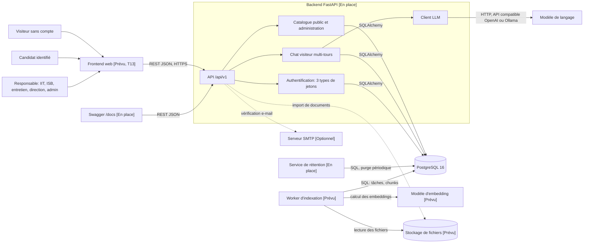
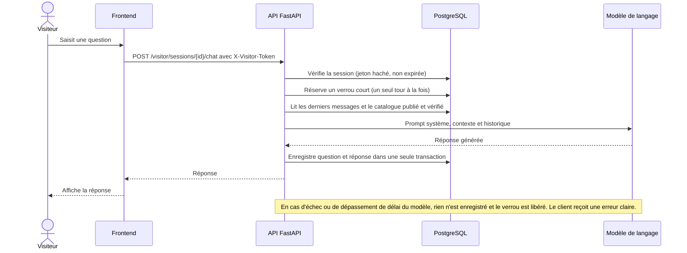
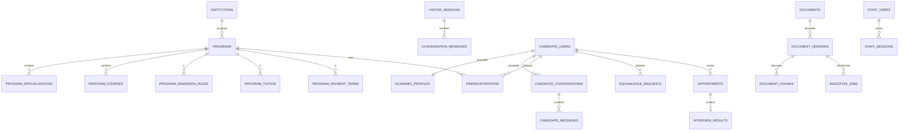

# SmartCampus AI — Architecture technique v0.3

> Mise à jour de la tâche T2. Chaque élément est marqué **[En place]** (code et tests existants) ou **[Prévu]** (à construire). Rien n'est présenté comme existant s'il ne l'est pas.

## 1. Vue d'ensemble

Les trois conteneurs actuels (voir `compose.yaml`) : **db** (PostgreSQL 16), **api** (FastAPI, exécute `alembic upgrade head` au démarrage) et **retention** (purge des données expirées). Le frontend, le worker d'indexation et le stockage de fichiers seront ajoutés avec T13 et T5.

## 2. Composants

| Composant | Rôle | État |
|---|---|---|
| Frontend | Interfaces publique (chat, catalogue), candidat (profil, préinscription), responsable (gestion) | **[Prévu]** T13 |
| API FastAPI | Routes REST versionnées `/api/v1`, validation Pydantic, documentation Swagger générée | **[En place]** |
| Authentification | Trois types de jetons séparés (voir §5) | **[En place]** |
| Catalogue | Établissements, formations, spécialités, matières, tarifs, modalités de paiement, règles d'admission, avec statut de publication, période de validité et source officielle vérifiée | **[En place]** |
| Chat visiteur | Conversation multi-tours, mémoire en base, verrou contre les requêtes simultanées, annulation de tour en cas d'échec du modèle | **[En place]** |
| Client LLM | Deux types de serveurs : API compatible OpenAI, ou Ollama natif ; délais d'attente, limite de sortie et de contexte configurables | **[En place]** |
| Contexte du chat | Le prompt reçoit uniquement les données **publiées et vérifiées** du catalogue | **[En place]** |
| Recherche documentaire (RAG) | Recherche dans les documents importés avant l'appel au modèle | **[Prévu]** |
| Tables de documents | Documents, versions, chunks, tâches d'indexation (sans colonne vectorielle pour l'instant) | **[En place]** schéma, **[Prévu]** traitement |
| Worker d'indexation | Extraction du texte, découpage, embeddings, mise à jour des chunks | **[Prévu]** |
| Rétention | Suppression périodique des messages, jetons et compteurs expirés | **[En place]** |
| Données de démonstration | `seed_demo.py` : données fictives, brouillons par défaut | **[En place]** |
| E-mail | Vérification d'adresse du candidat ; explicitement indisponible si SMTP n'est pas configuré | **[Optionnel]** |

## 3. Parcours principal : question d'un visiteur

**Cible avec RAG [Prévu] :** une étape s'ajoute entre la lecture de la base et l'appel au modèle : calcul de l'embedding de la question, recherche des chunks les plus proches dans les documents publiés, ajout au prompt avec leur source.

## 4. Données

Quatre groupes de tables, créés par les migrations Alembic 0001 à 0011 (`migrations/versions/`) :

1. **Catalogue** (0001, 0005, 0011) : établissements, formations et leurs détails (spécialités, matières, tarifs, paiement, admission).
2. **Identité et accès** (0002, 0003, 0004, 0006, 0007) : sessions visiteur et verrou de chat, comptes du personnel, comptes candidat, compteurs de limitation.
3. **Parcours candidat** (0008, 0009) : profil académique, conversations conservées, préinscriptions, équivalences, rendez-vous, résultats d'entretien.
4. **Documents** (0010) : documents, versions, chunks, tâches d'indexation.

Le rattachement d'une conversation visiteur à un compte candidat (T9) repose sur `candidate_conversations.source_visitor_session_id` : un seul rattachement possible, consentement obligatoire.

## 5. Sécurité et conformité

| Sujet | Mécanisme en place |
|---|---|
| Mots de passe | Argon2id ; jamais stockés en clair |
| Jetons | Trois familles séparées : **personnel** (Bearer), **candidat** (Bearer), **visiteur** (en-tête `X-Visitor-Token`). Jetons opaques de 256 bits, **seule l'empreinte SHA-256 est stockée**, expiration vérifiée à chaque appel, révocation possible |
| Droits | Rôles du personnel (administrateur, responsable IIT, responsable ISB, entretien, direction) ; un responsable d'établissement ne voit que son établissement ; la direction lit sans écrire |
| Premier compte | La clé d'administration sert **uniquement** au premier compte ; ensuite aucune route ne l'accepte |
| Abus | Limites serveur par heure : création de sessions visiteur, inscriptions et connexions candidat ; verrouillage du compte après échecs |
| Données publiques | Visibles seulement si : formation publiée + source officielle en HTTPS + date de vérification passée + statut de publication « publié » + dans la période de validité |
| Consentement et RGPD | Consentement obligatoire pour soumettre une préinscription ou rattacher une conversation ; rétention automatique ; suppression de compte par le candidat |
| Secrets | Variables d'environnement (`.env` non versionné) ; valeurs d'exemple refusées au démarrage ; URL du modèle sans secret, HTTPS obligatoire hors machine locale |
| Qualité de l'information | Décisions officielles (équivalence, validation du dossier, résultat d'entretien) réservées à un humain ; jamais de donnée officielle inventée |

## 6. Justification des choix technologiques

| Besoin | Choix | Alternative écartée | Raison |
|---|---|---|---|
| Backend | **FastAPI (Python 3.12)** | Django, Node.js/Express | Même langage que l'écosystème IA ; validation Pydantic ; documentation OpenAPI générée et testée par un test de contrat |
| Base de données | **PostgreSQL 16** | MySQL, MongoDB | Contraintes d'intégrité et index partiels (unicité conditionnelle), transactions, types précis (dates avec fuseau, montants décimaux) |
| Accès aux données | **SQLAlchemy 2 + Alembic** | SQL manuel | Modèles typés, migrations versionnées et vérifiées contre les modèles (`alembic check` en CI) |
| Recherche vectorielle | **pgvector dans PostgreSQL** [à décider, §7] | Qdrant, Weaviate, Chroma | Une seule base à sauvegarder, cohérence transactionnelle avec les versions de documents, volume modeste attendu |
| Authentification | **Jetons opaques hachés** | JWT autonomes | Révocation immédiate (déconnexion, changement de mot de passe), pas de secret de signature à protéger |
| Mots de passe | **Argon2id** | bcrypt | Recommandation actuelle, résistance au matériel dédié |
| Modèle de langage | **Interface unique, serveur au choix** (API compatible OpenAI ou Ollama) | Dépendance à un seul fournisseur | Permet la comparaison de T10 sans changer le code ; modèle local possible (confidentialité, coût) |
| Déploiement local | **Docker Compose** | Installation manuelle | Même environnement pour tous, démarrage en une commande |
| Qualité | **pytest, Ruff, CI GitHub** | Tests manuels | 200 tests ; la CI rejoue les migrations sur une vraie PostgreSQL |
| Frontend | **Next.js / React + TypeScript** [à confirmer, T13] | Vue, Angular | Écosystème large, types générables depuis le snapshot OpenAPI |

## 7. Décisions ouvertes (à trancher avant T9, T10, T12)

1. **pgvector.** Pour la recherche documentaire, il faut une extension, une colonne `vector(N)` dans `document_chunks` (la dimension N dépend du modèle d'embedding retenu), un index d'approximation (HNSW) et le passage de l'image `postgres:16-alpine` à `pgvector/pgvector:pg16`. Une migration 0012 additive en sera chargée. La table enregistre déjà le modèle d'embedding de chaque chunk, ce qui permet de changer de modèle plus tard.
2. **Stockage des fichiers.** Disque local en développement (volume Docker) ; objet compatible S3 (MinIO) en production. Seules les références (chemin, empreinte) sont en base.
3. **Worker d'indexation.** Soit un conteneur dédié qui interroge `ingestion_jobs`, soit un traitement lancé par l'API. La première option est préférable : tâches longues, reprises possibles, pas de blocage des requêtes.
4. **Choix du modèle de langage** : résultat de T10. Le modèle local actuellement testé est `qwen3.5:4b` via Ollama.
5. **Repli en cas de langue non comprise** (dialecte, Arabizi) : défini par T11, testé par T12.

## 8. Invariants conservés

1. Les migrations déjà publiées ne sont jamais modifiées : toute évolution passe par une nouvelle migration additive.
2. Une donnée n'est publique que si elle remplit toutes les conditions de la §5.
3. Un tour de chat est enregistré en entier (question et réponse) ou pas du tout.
4. Les données de démonstration sont fictives, préfixées `DEMO-` / `[DÉMO]`, jamais présentées comme officielles.
5. Les données officielles IIT/ISB sont collectées et validées par l'équipe avant publication.

## 9. Répartition des travaux

Voir `docs/BACKLOG_EVIDENCE.md` et le document d'état d'avancement du projet. Les tâches T1, T4, T5, T6, T7 et T8 sont terminées ; T2, T3, T9, T10, T11, T12 et T13 restent à faire.
