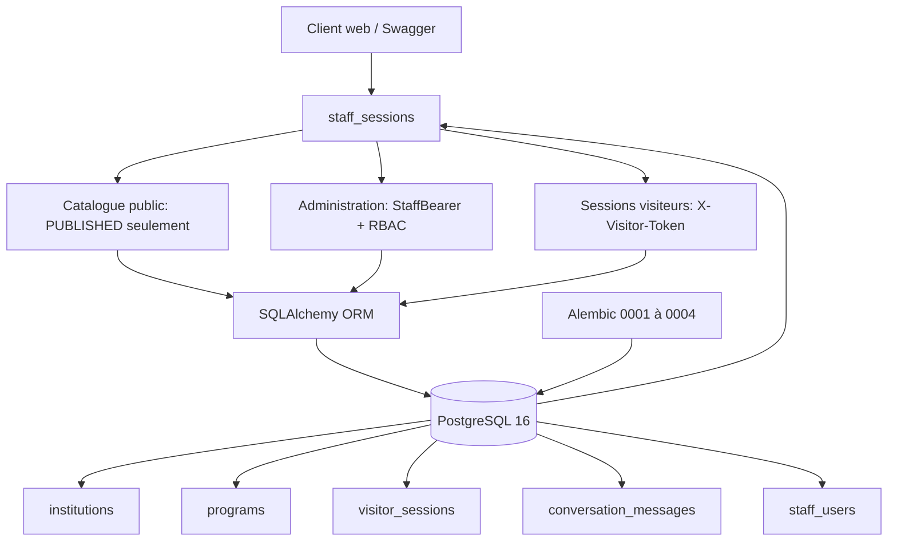
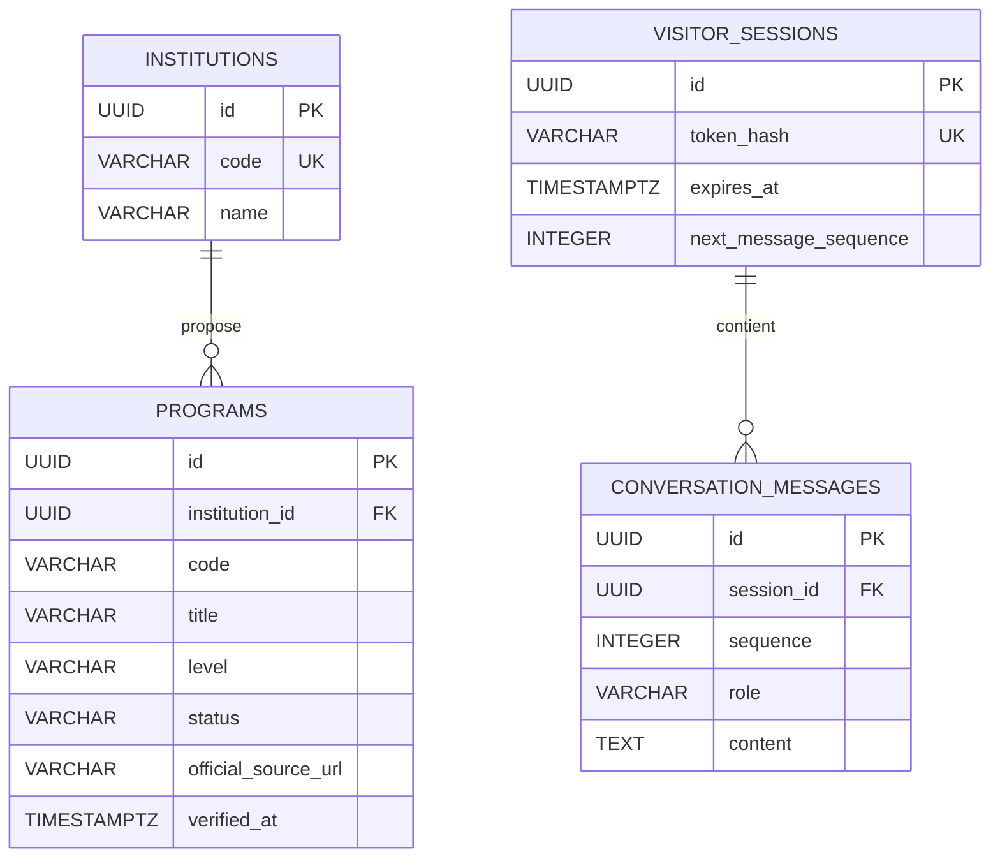

# SmartCampus AI — Architecture technique v0.2.0

## Flux métier actuellement implémentés

## Schéma relationnel

## Invariants et frontières

1. `0001_catalogue` est conservée à l'identique : nouvelles fonctionnalités ajoutées exclusivement dans `0002_visitor_memory`.
2. Un programme n'est consultable publiquement que s'il est publié avec URL et date de vérification.
3. Administration : comptes Argon2id, token opaque 256 bits révoquable, RBAC et isolement des responsables IIT/ISB. La clé historique n'autorise que le bootstrap initial ; après cela aucune route de catalogue ne l'accepte.
4. Visiteurs : sessions indépendantes, token 256 bits retourné une fois, empreinte SHA-256 en PostgreSQL, expiration vérifiée à chaque appel, plafond de messages.
5. Le modèle Ollama `qwen3.5:4b` est connecté et le test multi-tours a passé le 20 novembre 2026 sur le PC utilisateur. Le RAG documentaire complet et l'évaluation systématique Tunisien/Arabizi restent à faire.
6. Les données officielles IIT/ISB doivent être collectées et validées par l'équipe avant publication ; jamais d'informations inventées présentées comme officielles.

## Répartition des travaux

- Nous : SA-5, SA-7, SA-12, SA-16, SA-17, SA-20 et maintenant SA-25, SA-26 ; puis SA-36/37.
- Autres membres : SA-13/14 (candidatures/documents), SA-21/22 (tarifs et vérifications), SA-8/9 (frontend/env) et les autres tâches prévues. Coordonner les nouveaux modèles au moyen de migrations additives.
