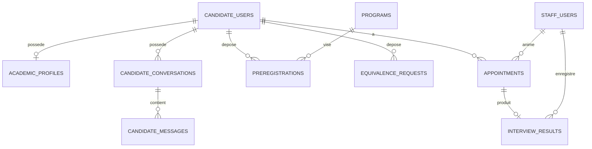
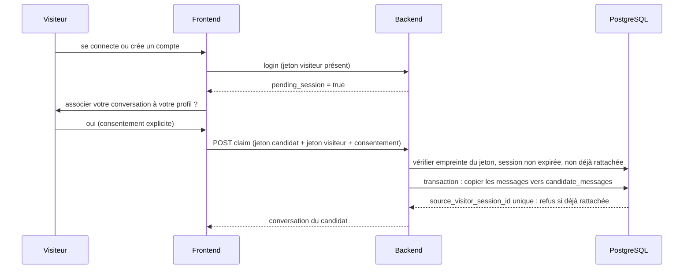
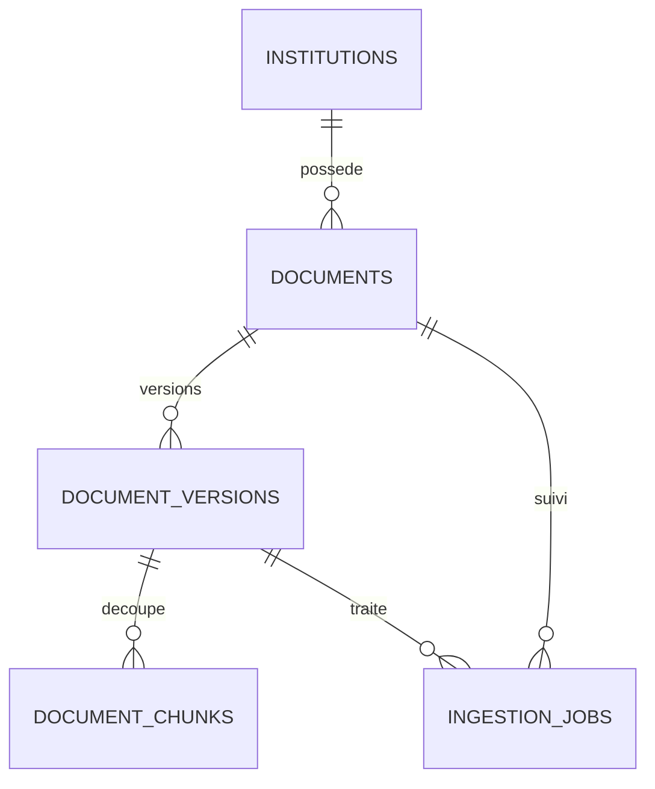

# SmartCampus AI — Modèle de données ajouté par les tâches T4 et T5

Migrations additives, à la suite de `0007_abuse_limits` : aucune table existante n'est modifiée ou supprimée.

| Migration | Contenu | Tâche |
|---|---|---|
| `0008_admission_requests` | `preregistrations`, `equivalence_requests`, `appointments`, `interview_results` | T4 |
| `0009_profile_conversations` | `academic_profiles`, `candidate_conversations`, `candidate_messages`, index « une préinscription active par programme » | T4 |
| `0010_documents_ingestion` | `documents`, `document_versions`, `document_chunks`, `ingestion_jobs` | T5 |

La prochaine migration (T7, paiement et validité des tarifs) sera `0011`.

## Les trois profils dans la base

| Profil | Table | Remarque |
|---|---|---|
| Visiteur sans compte | `visitor_sessions`, `conversation_messages` | Existantes : jeton haché, expiration 24 h |
| Candidat identifié | `candidate_users`, `candidate_sessions`, `academic_profiles`, `candidate_conversations`, `candidate_messages` | Profil académique séparé de la table des comptes |
| Responsable | `staff_users`, `staff_sessions` | 5 rôles |

## Candidat, demandes et conversations

### Rattachement d'une conversation visiteur (pour T9)

Contrôles à implémenter dans T9 : empreinte du jeton visiteur égale à celle en base (comparaison à temps constant), session non expirée, consentement vrai, tout dans une seule transaction. Codes attendus : 403 session d'un autre visiteur, 409 déjà rattachée, 410 expirée.

## Documents et indexation

### Flux d'indexation

| Événement | Ce que fait le backend | Ce que fait le worker |
|---|---|---|
| Import d'un document | Crée `documents` et une version (`sha256`, chemin, `is_current`) puis un job `ADD` en `PENDING` | Prend le job (`RUNNING`, bail `locked_until`), extrait le texte, écrit `document_chunks`, calcule les embeddings quand le vecteur sera disponible, termine en `SUCCEEDED` |
| Nouvelle version | Crée la version, passe l'ancienne à `is_current = false`, crée un job `UPDATE` | Remplace les chunks de l'ancienne version par ceux de la nouvelle |
| Suppression | Soft delete (`deleted_at`), crée un job `DELETE` | Retire les chunks du document de l'index |
| Échec | — | `FAILED` avec `error_message`, `attempts` incrémenté ; nouveau job possible jusqu'à `max_attempts` |

### Ajouter les vecteurs plus tard
Quand le modèle d'embedding sera choisi (T10), une migration ajoutera, par exemple, une table `chunk_embeddings (chunk_id, embedding vector(N))` avec l'extension pgvector. `document_chunks.embedding_model` et `embedded_at` indiquent déjà quels chunks sont indexés et avec quel modèle. Ce changement nécessitera l'image `pgvector/pgvector:pg16` : à tester sur une base neuve.
