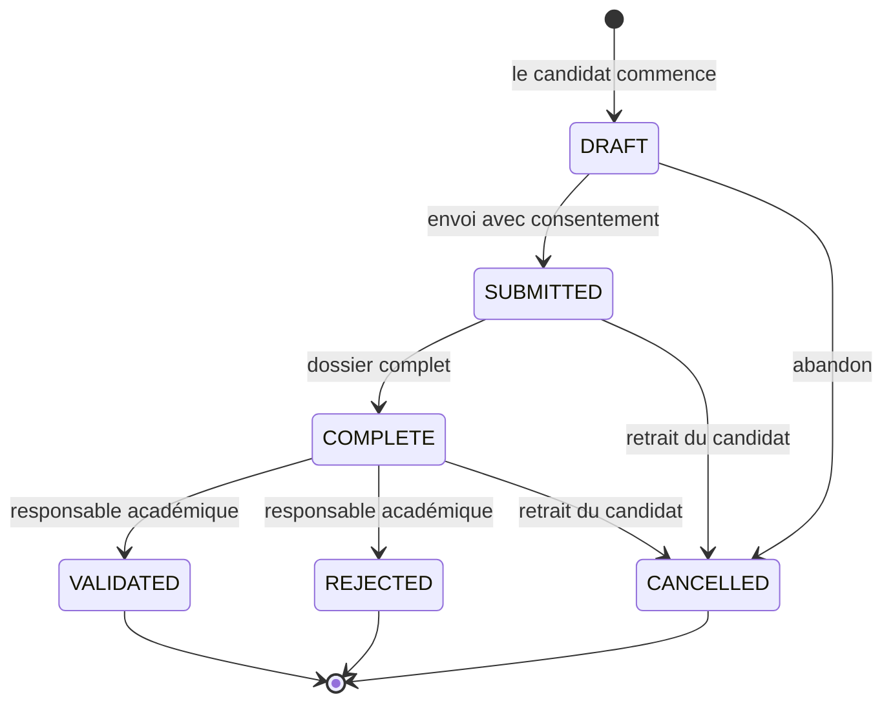
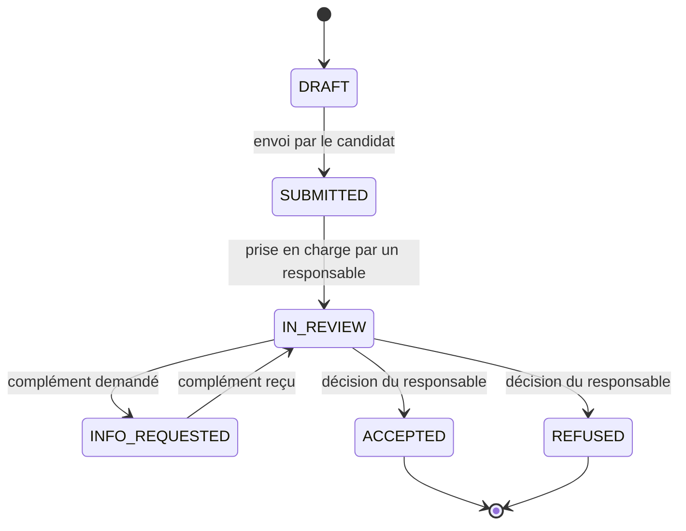
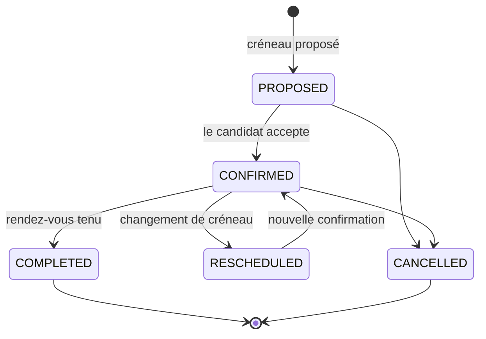
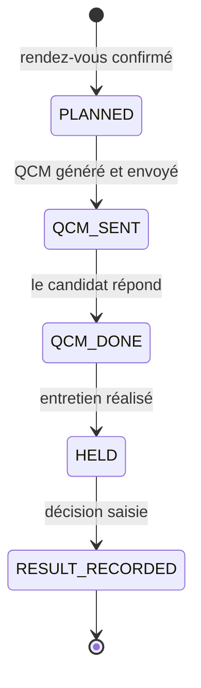
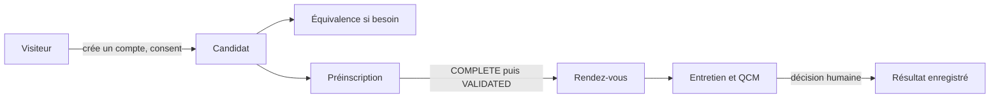

# SmartCampus AI — Utilisateurs, droits et processus des demandes (T1)

Ce document décrit qui utilise la plateforme et comment sont traitées les demandes d'équivalence, de préinscription, de rendez-vous et d'entretien. Les statuts ci-dessous sont **les valeurs exactes** des contraintes CHECK de la migration `0008_admission_requests` (`app/models/admission.py`).

## 1. Les trois types d'utilisateurs

| Profil | Identification dans le backend | Peut | Ne peut pas |
|---|---|---|---|
| **Visiteur sans compte** | Session anonyme : `POST /api/v1/visitor/sessions`, jeton `X-Visitor-Token` (haché en base, expire après 24 h, 200 messages max) | Discuter avec le chatbot, consulter les formations publiées et leurs détails vérifiés | Se préinscrire, passer un QCM, prendre rendez-vous, retrouver sa conversation après expiration |
| **Candidat identifié** | Compte `candidate_users`, jeton bearer candidat (distinct du jeton staff et du jeton visiteur) | Tout ce que fait le visiteur, plus : profil académique, demande d'équivalence, préinscription, QCM, consulter ses rendez-vous et notifications, supprimer son compte | Voir les dossiers des autres, modifier le catalogue, enregistrer une décision officielle |
| **Responsable** | Compte `staff_users`, jeton bearer staff, champ `role` | Selon le rôle (section 2) | Utiliser un jeton candidat ou visiteur |

### Rattachement des acteurs du sujet aux profils

| Acteur du sujet PDF | Profil | Rôle backend (`StaffRole`) |
|---|---|---|
| Candidat / futur étudiant | Visiteur puis candidat identifié | — |
| Responsable académique IIT | Responsable | `ACADEMIC_IIT` (limité à l'institution IIT) |
| Responsable académique ISB | Responsable | `ACADEMIC_ISB` (limité à l'institution ISB) |
| Responsable entretien | Responsable | `INTERVIEW_MANAGER` |
| Direction | Responsable (lecture et statistiques) | `DIRECTION` |
| Administrateur de la plateforme | Responsable | `PLATFORM_ADMIN` |

## 2. Matrice des droits

Légende : L = lire, É = écrire / modifier, D = décider (décision officielle), — = aucun droit. « propre » = uniquement ses propres données.

| Ressource | Visiteur | Candidat | ACADEMIC_IIT/ISB | INTERVIEW_MANAGER | DIRECTION | PLATFORM_ADMIN |
|---|---|---|---|---|---|---|
| Catalogue publié (programmes, tarifs vérifiés) | L | L | L | L | L | L |
| Catalogue en brouillon | — | — | L, É (son institution) | — | L | L, É |
| Conversation | propre (session) | propre | — | résumé des candidats préinscrits | — | — |
| Profil académique | — | propre (L, É) | candidats orientés vers son institution (L) | candidats à entretenir (L) | statistiques | L |
| Préinscription | — | propre (L, É avant envoi) | L, D (valider ou rejeter) pour son institution | L | statistiques | L, D |
| Demande d'équivalence | — | propre (L, É avant envoi) | L, D pour son institution | — | statistiques | L, D |
| Rendez-vous | — | propre (L, confirmer ou annuler) | — | L, É (proposer, replanifier) | statistiques | L, É |
| Résultat d'entretien | — | — | L | L, É, D | statistiques | L |
| Comptes staff, rôles, journaux | — | — | — | — | — | L, É |

Règle générale : toute **décision officielle** (équivalence, validation de préinscription, résultat d'entretien) est prise par un humain. L'agent IA peut préparer, résumer et proposer, mais ne change jamais ces statuts.

## 3. Cycle de vie des demandes

### 3.1 Préinscription (`preregistrations`)

- Le consentement (`consent_given_at`) est obligatoire dès que le statut n'est plus `DRAFT` (contrainte `ck_prereg_consent_required`).
- `VALIDATED` et `REJECTED` : seul un responsable (`reviewed_by`, `reviewed_at`, `review_note`).

### 3.2 Équivalence (`equivalence_requests`)

- Le diplôme et l'établissement d'origine sont obligatoires.
- Une équivalence n'est **jamais** décidée par l'IA : `ACCEPTED` et `REFUSED` sont réservés au responsable.

### 3.3 Rendez-vous (`appointments`)

- Contrainte de base : `ends_at > starts_at`.
- Les invitations et rappels sont envoyés par e-mail ; l'envoi dépend de la configuration SMTP.

### 3.4 Entretien (`interview_results`)

- Un seul résultat par rendez-vous (`uq_interview_appointment`).
- La décision (`ADMITTED`, `WAITLIST`, `REFUSED`, `INFO_NEEDED`) n'est autorisée que si le statut est `RESULT_RECORDED`.
- Le score du QCM est compris entre 0 et 100.

## 4. Transitions : qui, quand, quelle notification

« Candidat » = le candidat identifié. « Agent IA » = l'agent conversationnel, qui ne peut déclencher que les transitions marquées *IA possible* et seulement avec l'accord du candidat. Les e-mails dépendent de la configuration SMTP (voir README).

### Préinscription

| De → vers | Déclencheur | Condition | Notification |
|---|---|---|---|
| (création) → DRAFT | Candidat ou agent IA (IA possible) | Compte candidat existant ; une seule préinscription active par programme (index `uq_prereg_active_candidate_program`) | Aucune |
| DRAFT → SUBMITTED | Candidat | Consentement enregistré (`consent_given_at`) | Accusé de réception au candidat ; alerte au responsable académique de l'institution |
| SUBMITTED → COMPLETE | Responsable académique | Pièces et informations requises présentes | Candidat informé |
| COMPLETE → VALIDATED | Responsable académique | **Décision humaine** | Candidat informé ; rendez-vous à proposer |
| COMPLETE → REJECTED | Responsable académique | **Décision humaine**, motif dans `review_note` | Candidat informé |
| DRAFT, SUBMITTED, COMPLETE → CANCELLED | Candidat | À tout moment avant la décision | Responsable informé |

### Équivalence

| De → vers | Déclencheur | Condition | Notification |
|---|---|---|---|
| DRAFT → SUBMITTED | Candidat | Diplôme et établissement d'origine renseignés | Accusé de réception ; alerte au responsable |
| SUBMITTED → IN_REVIEW | Responsable académique | Prise en charge | Candidat informé |
| IN_REVIEW → INFO_REQUESTED | Responsable académique | Liste du complément demandé | Candidat invité à compléter |
| INFO_REQUESTED → IN_REVIEW | Candidat | Complément envoyé | Responsable informé |
| IN_REVIEW → ACCEPTED / REFUSED | Responsable académique | **Décision humaine**, motif dans `decision_note` | Candidat informé |

### Rendez-vous

| De → vers | Déclencheur | Condition | Notification |
|---|---|---|---|
| (création) → PROPOSED | Responsable entretien ou agent IA (IA possible) | Préinscription au moins `COMPLETE` ; créneau libre, dans les règles autorisées | Invitation au candidat |
| PROPOSED → CONFIRMED | Candidat | Acceptation | Confirmation aux deux parties ; rappel avant la date |
| CONFIRMED → RESCHEDULED → CONFIRMED | Candidat ou responsable | Nouveau créneau accepté | Nouvelle invitation |
| PROPOSED, CONFIRMED → CANCELLED | Candidat ou responsable | À tout moment avant la date | Autre partie informée |
| CONFIRMED → COMPLETED | Responsable entretien | Rendez-vous tenu | Aucune |

### Entretien

| De → vers | Déclencheur | Condition | Notification |
|---|---|---|---|
| (création) → PLANNED | Système | Rendez-vous confirmé | Aucune |
| PLANNED → QCM_SENT | Agent IA (IA possible) | QCM généré pour le parcours et le profil | Lien du QCM envoyé au candidat |
| QCM_SENT → QCM_DONE | Candidat | QCM terminé et corrigé (`qcm_score` entre 0 et 100) | Synthèse prête pour le responsable |
| QCM_DONE → HELD | Responsable entretien | Entretien réalisé | Aucune |
| HELD → RESULT_RECORDED | Responsable entretien | **Décision humaine** (`ADMITTED`, `WAITLIST`, `REFUSED`, `INFO_NEEDED`) + observations | Candidat informé selon la décision |

### Règles transversales
- **Consentement** : aucune donnée ne passe de visiteur à candidat sans accord explicite (conversation, profil) ; la préinscription exige un consentement horodaté.
- **Décisions officielles** : validation de préinscription, équivalence et résultat d'entretien sont toujours humains.
- **Relances** : un dossier inactif déclenche une relance personnalisée, tracée ; au-delà d'un seuil défini par la direction, il est confié à un conseiller humain.
- **Suppression** : la suppression du compte candidat supprime ses demandes, son profil et ses conversations (clés étrangères en cascade).

## 5. Enchaînement global

## 6. Décisions prises (avec justification)

| Sujet | Décision | Pourquoi |
|---|---|---|
| Conversation d'un visiteur qui crée un compte (T4 / T9) | Nouvelles tables `candidate_conversations` et `candidate_messages`. Au rattachement (T9), les messages de la session visiteur y sont **copiés** dans une transaction. Les tables visiteur ne sont pas modifiées. | Le chat qui fonctionne et ses tests restent intacts ; les données visiteur continuent d'expirer sauf accord explicite ; `source_visitor_session_id` unique empêche de rattacher deux fois la même session. |
| pgvector (T5) | Pas de changement d'image Docker maintenant. Les tables de documents, versions, chunks et jobs n'en dépendent pas ; la colonne vectorielle viendra dans une migration ultérieure, une fois le modèle d'embedding choisi (T10). | La dimension du vecteur dépend du modèle ; changer l'image Postgres sur une base existante est risqué ; les tests et la migration restent exécutables partout. |
| Version courante d'un document | Colonne `is_current` avec index unique partiel, sans clé étrangère circulaire. | Simple, vérifié par la base elle-même. |
| Fichier envoyé deux fois | Rejeté via `sha256` unique par document. | Évite les doublons de versions. |
| Jobs d'indexation | Index unique partiel : un seul job actif par version et action. Bail (`locked_until`) pour reprendre un job interrompu. | Rend l'import idempotent et robuste aux pannes du worker. |
| Plusieurs préinscriptions pour un même programme | Une seule active (`SUBMITTED`, `COMPLETE`, `VALIDATED`, `DRAFT`) ; une annulée ou rejetée n'empêche pas de recommencer. | Évite les doublons sans bloquer une nouvelle candidature. |
