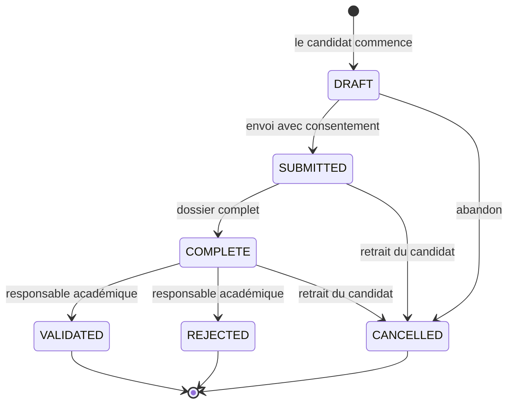
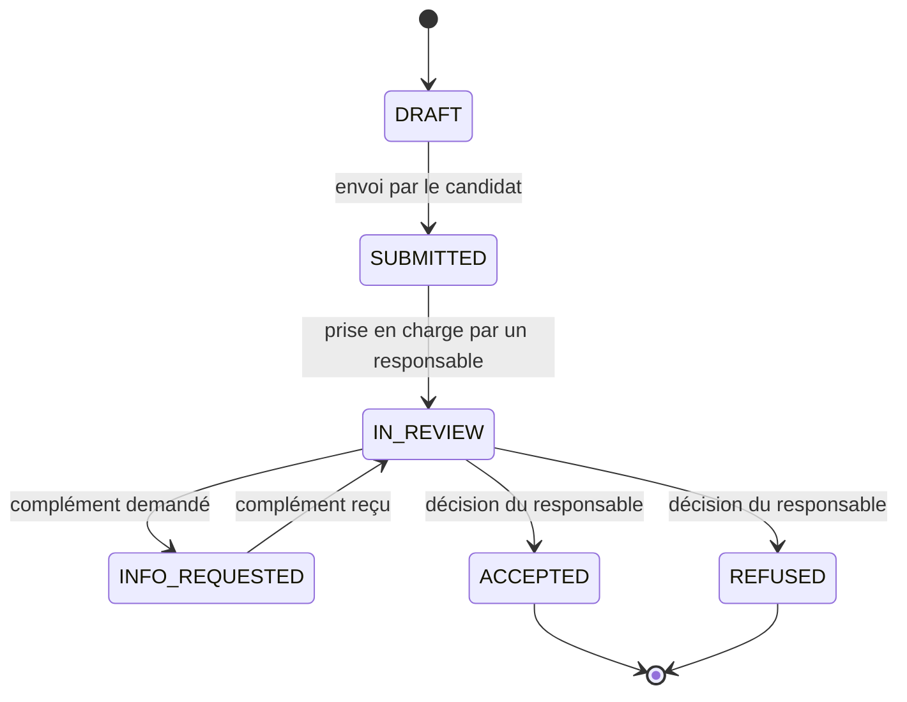
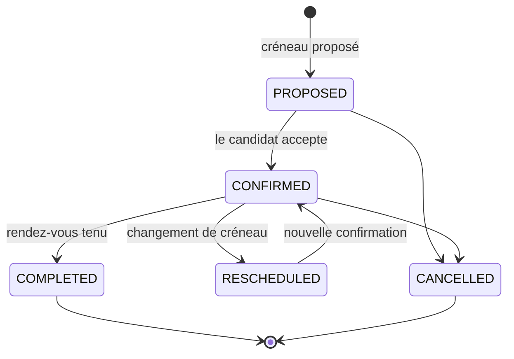
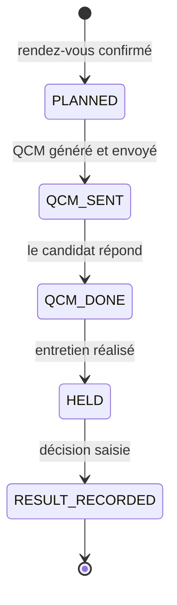
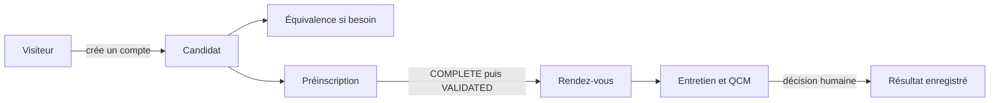

# SmartCampus AI — Utilisateurs, droits et processus des demandes (T1)

Ce document décrit qui utilise la plateforme et comment sont traitées les demandes d'équivalence, de préinscription, de rendez-vous et d'entretien. Les statuts ci-dessous sont **les valeurs exactes** des contraintes CHECK de la migration `0008_admission_requests` (`app/models/admission.py`).

## 1. Les trois types d'utilisateurs

| Profil | Identification dans le backend | Peut | Ne peut pas |
|---|---|---|---|
| **Visiteur sans compte** | Session anonyme : `POST /api/v1/visitor/sessions`, jeton `X-Visitor-Token` (haché en base, expire après 24 h, 200 messages max) | Discuter avec le chatbot, consulter les formations publiées et leurs détails vérifiés | Se préinscrire, passer un QCM, prendre rendez-vous, retrouver sa conversation après expiration |
| **Candidat identifié** | Compte `candidate_users`, jeton bearer candidat (distinct du jeton staff et du jeton visiteur) | Tout ce que fait le visiteur, plus : profil académique, demande d'équivalence, préinscription, QCM, consulter ses rendez-vous et notifications, supprimer son compte | Voir les dossiers des autres, modifier le catalogue, enregistrer une décision officielle |
| **Responsable** | Compte `staff_users`, jeton bearer staff, champ `role` | Selon le rôle (section 2) | Utiliser un jeton candidat ou visiteur |

### Rattachement des acteurs du sujet aux profils

| Acteur du sujet PDF | Profil | Rôle backend (`StaffRole`) |
|---|---|---|
| Candidat / futur étudiant | Visiteur puis candidat identifié | — |
| Responsable académique IIT | Responsable | `ACADEMIC_IIT` (limité à l'institution IIT) |
| Responsable académique ISB | Responsable | `ACADEMIC_ISB` (limité à l'institution ISB) |
| Responsable entretien | Responsable | `INTERVIEW_MANAGER` |
| Direction | Responsable (lecture et statistiques) | `DIRECTION` |
| Administrateur de la plateforme | Responsable | `PLATFORM_ADMIN` |

## 2. Matrice des droits

Légende : L = lire, É = écrire / modifier, D = décider (décision officielle), — = aucun droit. « propre » = uniquement ses propres données.

| Ressource | Visiteur | Candidat | ACADEMIC_IIT/ISB | INTERVIEW_MANAGER | DIRECTION | PLATFORM_ADMIN |
|---|---|---|---|---|---|---|
| Catalogue publié (programmes, tarifs vérifiés) | L | L | L | L | L | L |
| Catalogue en brouillon | — | — | L, É (son institution) | — | L | L, É |
| Conversation | propre (session) | propre | — | résumé des candidats préinscrits | — | — |
| Profil académique | — | propre (L, É) | candidats orientés vers son institution (L) | candidats à entretenir (L) | statistiques | L |
| Préinscription | — | propre (L, É avant envoi) | L, D (valider ou rejeter) pour son institution | L | statistiques | L, D |
| Demande d'équivalence | — | propre (L, É avant envoi) | L, D pour son institution | — | statistiques | L, D |
| Rendez-vous | — | propre (L, confirmer ou annuler) | — | L, É (proposer, replanifier) | statistiques | L, É |
| Résultat d'entretien | — | — | L | L, É, D | statistiques | L |
| Comptes staff, rôles, journaux | — | — | — | — | — | L, É |

Règle générale : toute **décision officielle** (équivalence, validation de préinscription, résultat d'entretien) est prise par un humain. L'agent IA peut préparer, résumer et proposer, mais ne change jamais ces statuts.

## 3. Cycle de vie des demandes

### 3.1 Préinscription (`preregistrations`)

- Le consentement (`consent_given_at`) est obligatoire dès que le statut n'est plus `DRAFT` (contrainte `ck_prereg_consent_required`).
- `VALIDATED` et `REJECTED` : seul un responsable (`reviewed_by`, `reviewed_at`, `review_note`).

### 3.2 Équivalence (`equivalence_requests`)

- Le diplôme et l'établissement d'origine sont obligatoires.
- Une équivalence n'est **jamais** décidée par l'IA : `ACCEPTED` et `REFUSED` sont réservés au responsable.

### 3.3 Rendez-vous (`appointments`)

- Contrainte de base : `ends_at > starts_at`.
- Les invitations et rappels sont envoyés par e-mail ; l'envoi dépend de la configuration SMTP.

### 3.4 Entretien (`interview_results`)

- Un seul résultat par rendez-vous (`uq_interview_appointment`).
- La décision (`ADMITTED`, `WAITLIST`, `REFUSED`, `INFO_NEEDED`) n'est autorisée que si le statut est `RESULT_RECORDED`.
- Le score du QCM est compris entre 0 et 100.

## 4. Enchaînement global

## 5. Points à décider avec la Personne B

1. **Propriété d'une conversation (T9).** Aujourd'hui `conversation_messages` référence `visitor_sessions` avec suppression en cascade : à l'expiration de la session (24 h), les messages sont purgés. Pour qu'un candidat garde sa conversation, il faut soit déplacer les messages vers un propriétaire candidat, soit ajouter une table `conversations` possédée par un candidat. La migration 0008 **ne modifie pas** ces tables existantes ; le choix doit être fait avec la Personne B avant la migration 0009/0010 correspondante.
2. **pgvector (T5)** : image `pgvector/pgvector:pg16` à tester sur une base neuve avant d'y toucher.
