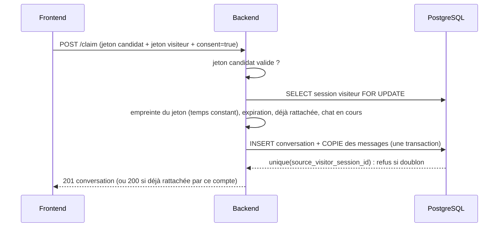

# T9 — Conserver la conversation d'un visiteur après connexion

Un visiteur anonyme discute avec l'agent, puis crée un compte ou se connecte. Avec son **consentement explicite**, sa conversation est **copiée** dans son profil candidat. Les données visiteur ne sont pas modifiées et expirent comme avant.

## Endpoints (préfixe `/api/v1/candidates/me/conversations`)

| Méthode | Chemin | Rôle |
|---|---|---|
| POST | `/claim` | Rattache une conversation visiteur au compte (deux preuves + consentement) |
| GET | `` | Liste de mes conversations |
| GET | `/{id}` | Une de mes conversations |
| GET | `/{id}/messages?limit&offset` | Messages paginés (50 par défaut, 200 max) |
| DELETE | `/{id}` | Suppression définitive (messages inclus) |

## Requête de rattachement

```
POST /api/v1/candidates/me/conversations/claim
Authorization: Bearer <jeton candidat>
X-Visitor-Token: <jeton de la session visiteur>
{"visitor_session_id": "<uuid>", "consent": true}
```

## Contrôles et codes de retour

| Situation | Code |
|---|---|
| Jeton candidat absent ou invalide (un jeton staff n'est pas accepté) | 401 |
| Jeton visiteur absent | 401 |
| `consent` absent ou `false` | 422 |
| Jeton visiteur ne correspond pas à la session (comparaison à temps constant) | 403 |
| Session visiteur inconnue ou déjà purgée (et jamais rattachée par ce compte) | 404 |
| Session visiteur expirée | 410 |
| Session déjà rattachée à **un autre** compte | 409 |
| Session sans aucun message | 409 |
| Réponse du modèle en cours dans cette session (verrou de chat) | 409 |
| Même candidat qui répète la demande (double clic, autre appareil) | **200**, même conversation, `already_claimed: true` |
| Première réussite | **201** |
| Conversation d'un autre candidat (lecture, messages, suppression) | 404 (même réponse que « inexistante ») |

## Garanties

- **Transaction unique** : tous les messages sont copiés ou aucun. Le verrou de ligne sur la session visiteur (PostgreSQL) et la contrainte unique `source_visitor_session_id` empêchent une double copie.
- Numérotation et ordre des messages conservés ; `original_created_at` garde la date d'origine.
- Le titre est le premier message de l'utilisateur, tronqué à 180 caractères.
- Après la purge de la session visiteur, la conversation du candidat reste (pas de clé étrangère), et une répétition de la demande réussit toujours.

## Séquence



## Pour le frontend (T13)

Après `POST /candidates/login`, si un jeton visiteur existe dans le navigateur, afficher « Voulez-vous associer votre conversation à votre profil ? ». Si oui, appeler `/claim`. Si non, ne rien appeler : la conversation expire normalement. Après un 201 ou un 200, le jeton visiteur peut être oublié.

## Tests

`tests/test_t9_claim_conversation.py` (12 tests) : copie ordonnée, visiteur intact, consentement, deux preuves, session d'un autre visiteur, inconnue, expirée, double clic, autre compte, session vide, chat en cours, purge visiteur, confidentialité entre candidats, suppression, pagination.

Les tests SQLite n'exercent pas le verrou `FOR UPDATE` : le vérifier avec `TEST_DATABASE_URL` (CI PostgreSQL).

## Revue de sécurité (auto-relecture)

Points vérifiés : double preuve (jeton candidat + jeton visiteur), comparaison à temps constant, 404 identique pour « inexistant » et « à un autre », consentement obligatoire (422), copie en une transaction avec verrou et contrainte unique, suppression du compte candidat en cascade sur ses conversations, aucun jeton écrit en base ni journalisé, limite de 30 tentatives de rattachement par heure et par candidat (429).

Limites connues, à connaître avant la mise en production :
1. **Copie figée** : les messages échangés après le rattachement restent dans la session visiteur et ne sont pas recopiés. Le chat existant ne fonctionne qu'avec une session visiteur ; il n'existe pas encore de chat sur une conversation candidat. À traiter avec T13.
2. **404 contre 403** : un candidat connecté peut savoir si un identifiant de session existe. Les identifiants sont des UUID aléatoires et la limite de tentatives rend l'énumération impraticable ; risque accepté.
3. **Verrou `FOR UPDATE`** non exercé par les tests SQLite : à confirmer en CI PostgreSQL (`TEST_DATABASE_URL`).
4. **Relecture non indépendante** : cette revue a été faite par l'auteur du code ; une relecture humaine de la PR reste préférable.
